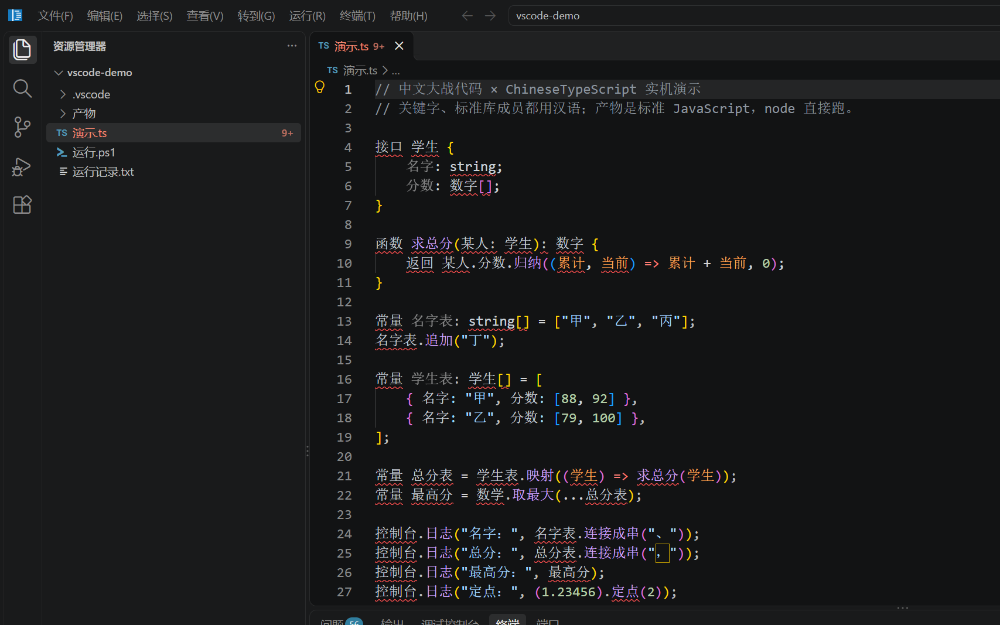
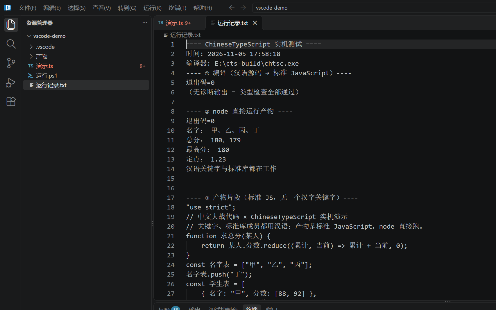

# 实机测试：在「中文大战代码」里用 ChineseTypeScript（2026-11-05）

被测软件：`E:\ChineseVSCode\VSCode-win32-x64\中文大战代码.exe`（VS Code 1.142.0 汉化版，产品名 中文大战代码）
被测对象：本仓库的编译器 `chtsc`（`91fca523` 之后的构建，含符号感知与自动加载）

## 一、怎么测的

| 步骤 | 做法 |
|---|---|
| 1 | 新建工作区 `E:\cts-build\vscode-demo`，放一个**全汉语**程序 `演示.ts`（汉语关键字 + 汉语标准库名） |
| 2 | 工作区 `.vscode/tasks.json` 里定义任务「CTS：用汉语编译并运行」，`runOn: folderOpen`（打开文件夹自动跑） |
| 3 | 任务调用 `运行.ps1`：`chtsc 演示.ts` 编译 → `node 产物/演示.js` 运行 → 全过程写进 `运行记录.txt` |
| 4 | 用 `--user-data-dir` 隔离一个干净的配置目录，启动软件、打开工作区、截图 |

## 二、结果：编译器这一层 —— 通过





`运行记录.txt`（真机截图里的原文）：

```
==== ChineseTypeScript 实机测试 ====
时间: 2026-11-05 17:58:18
编译器: E:\cts-build\chtsc.exe
---- ① 编译（汉语源码 → 标准 JavaScript）----
退出码=0
（无诊断输出 = 类型检查全部通过）
---- ② node 直接运行产物 ----
退出码=0
名字： 甲、乙、丙、丁
总分： 180，179
最高分： 180
定点： 1.23
汉语关键字与标准库都在工作
--- ③ 产物片段（标准 JS，无一个汉字关键字）----
function 求总分(某人) {
    return 某人.分数.reduce((累计, 当前) => 累计 + 当前, 0);
}
const 名字表 = ["甲", "乙", "丙"];
名字表.push("丁");
```

**三条同时成立**（正是设计要点）：

1. **关键字汉语化**：`接口/函数/返回/常量/如果/否则` 都被接受，产物里落回 `function/return/const/if/else`；
2. **标准库汉语化**：`名字表.追加`→`push`、`.归纳`→`reduce`、`数学.取最大`→`Math.max`、`控制台.日志`→`console.log`；
3. **用户自己的名字一个不动**：`求总分`、`某人`、`分数`、`名字表`、`总分表` 在产物里原样保留（符号感知），注释也原样保留。

## 三、发现（必须记下来的两条）

### 1. 编辑器里的类型检查仍然是**上游 TypeScript**，不是我们

软件自带的 TypeScript 扩展日志：

```
Starting TS Server
Using tsserver from: ...\extensions\node_modules\typescript\lib\tsserver.js
```

那个 tsserver 是**上游 6.0.3 的 JS 实现**。拿它检查同一个 `演示.ts`：

```
上游 TypeScript 6.0.3 诊断数=56
  行4 TS1434: Unexpected keyword or identifier.
  行6 TS1011: An element access expression should take an argument.
  ...
```

也就是说：**同样的代码，我们的编译器 0 诊断通过，编辑器里却红 56 处**（资源管理器里文件名后面那个 `9+` 徽标就是它）。
原因不是我们的机制有问题，而是 **VS Code 的 TS 扩展只会加载 JS 版语言服务**，而我们的语言服务是 Go 的。

→ 这是「用了中文版 VS Code 的人为何还会看到红波浪线」的**唯一**原因，也是下一步最值得做的一件事（见四）。

### 2. 从命令行启动这个软件要清 `ELECTRON_RUN_AS_NODE`

本机环境里存在 `ELECTRON_RUN_AS_NODE=1`（Electron 打包/工具链留下的）。带着它启动：

```
Error: Cannot find module 'E:\cts-build\vscode-demo'
Node.js v24.21.0
```

—— 软件被当成 node 去跑参数里的路径了。启动前 `Remove-Item Env:ELECTRON_RUN_AS_NODE` 即可（本仓库的截图就是这样跑出来的）。
`bin\cdzc.cmd` 这个命令行包装器则**故意**设置该变量（它就是要以 node 方式跑 `out/cli.js`），两者不要混用。

## 四、下一步建议（按性价比排序）

1. **给编辑器接上我们的语言服务**：我们已有 Go 的 `tsc/internal/ls`；做一个极薄的 stdio/LSP 桥 + 一个 VS Code 扩展（或改 `typescript-language-features` 的加载路径）。做成后，编辑器里的补全、悬浮、诊断就都是汉语的，红波浪线消失。
2. **过渡手段**：把 `typescript.tsdk` 指向一个「用我们 Go 编译器生成、带汉语增补的标准 `typescript` 包」——只能解决标准库名字，解决不了汉语关键字（关键字要靠词法层）。
3. 把这份测试固化成判定：`tests-chts/judge_vscode.ps1`（检查 `E:\ChineseVSCode` 存在时才跑，否则跳过），避免以后回归。
